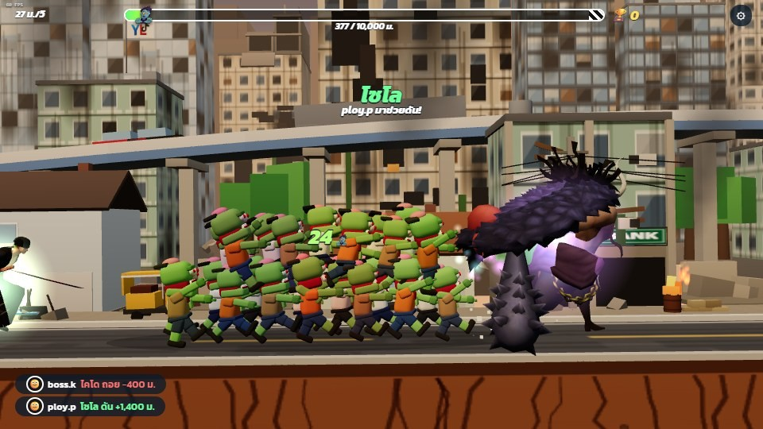
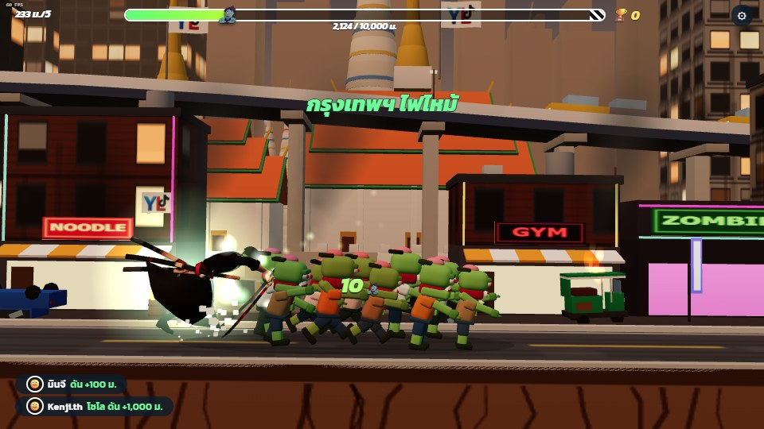
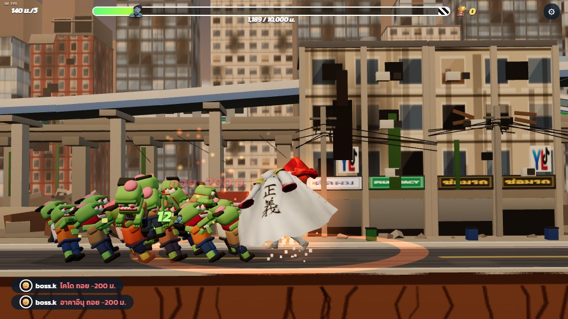
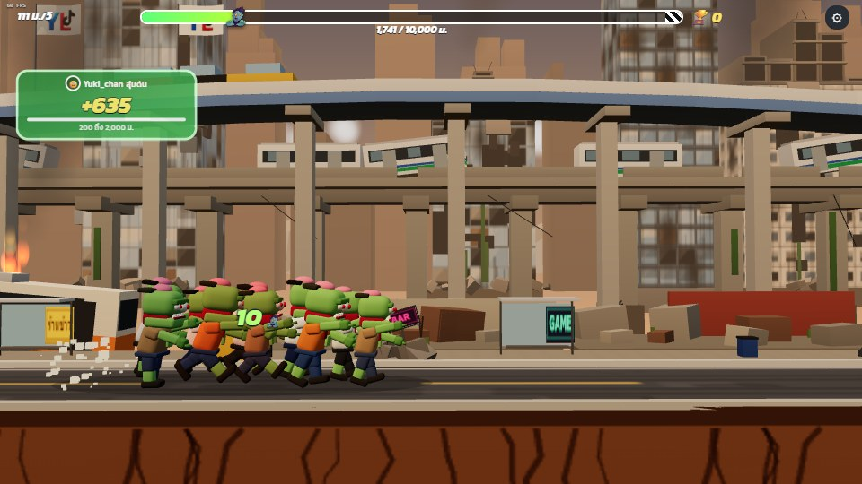
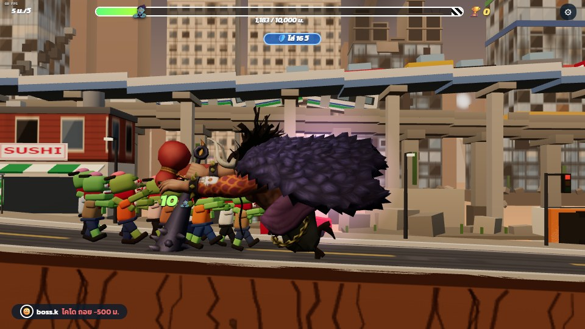
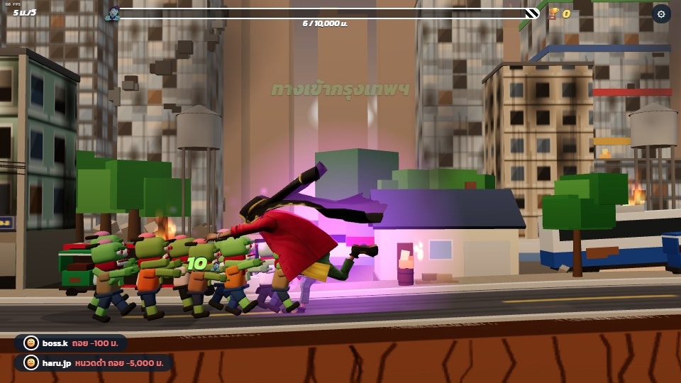
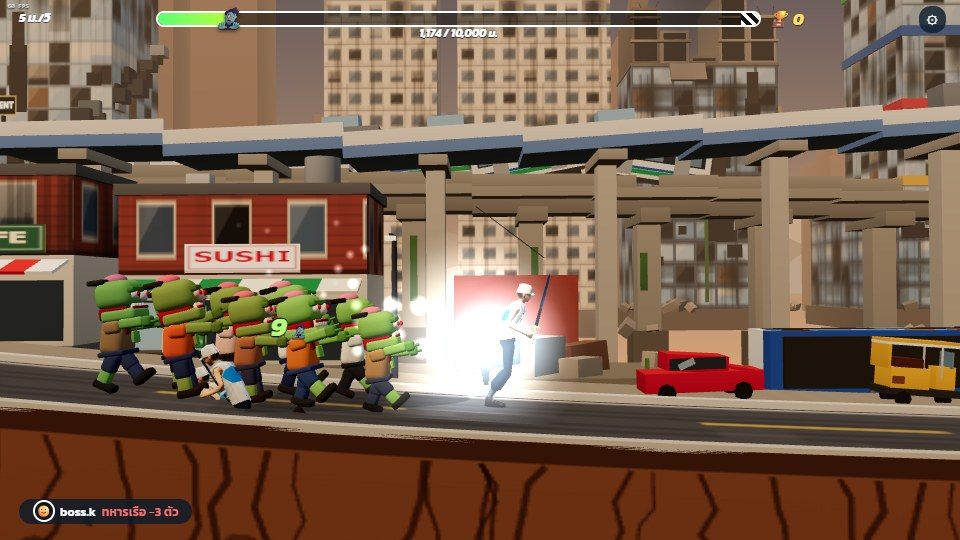
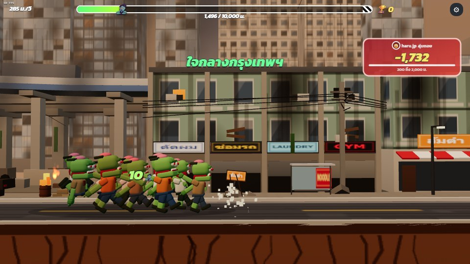
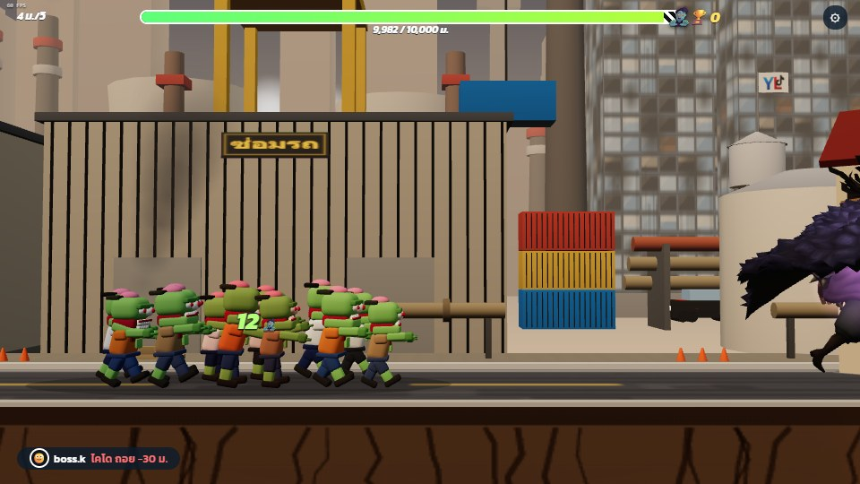

# ซอมบี้กินสมอง (ZombieYL) — gift commands

**A YL game** (YL Entertainment licence) · runs on **YLTik** · not part of AVO Play.

A TikTok live push race: a zombie horde (it starts as one zombie) runs 10,000 m to a house and knocks its door down. Eating a
person adds a zombie; viewers' gifts push the horde forward (help) or shove it back and kill zombies (prank). No zombies left =
lose and restart; breaking the door = win (+1 on the YLTik win counter). This repo is the command page only — each gift command
with a short clip of what it does in the game, plus the YLTik preset and its pictures.

**Page:** https://command-by-avo.github.io/zombie-commands/

| Help push | Characters | Random help | Shield |
|---|---|---|---|
|  |  |  |  |

| Prank shove | Kill | Random prank | The door |
|---|---|---|---|
|  |  |  |  |

## Commands
- `push N` — push the horde N metres forward · `back N` — shove it N metres back
- `luffy N` `zoro N` `whitebeard N` — a hero runs in from behind and pushes N metres
- `kaido N` `akainu N` `blackbeard N` — a villain comes from the front and shoves N metres back
- `marine N` — kills N zombies
- `shield S` — no prank lands for S seconds
- `random help LO HI` / `random prank LO HI` — a spinning card picks the metres
- A prank during the door knock restarts it ("โดนแกล้ง! นับใหม่").

## YLTik preset
[`zombie-yltik-preset.jnt`](zombie-yltik-preset.jnt) — import it in YLTik. Each rule sends its command over WebSocket; the two win
gifts are Webhook rules to YLTik's own win counter.

Part of [Command BY AVO](https://github.com/Command-BY-AVO) — one page per game, gift commands + clips.
